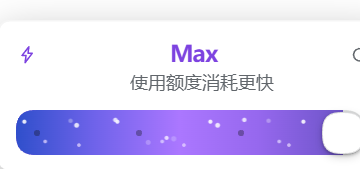

# Effort Dial Plus · 推理强度拨盘 Plus

把 Codex 的推理强度卡片搬进 DeepSeek Harness 的输入框：一个控件同时管模型选择和思考档位。



融合了 [dsh-effort-dial](https://github.com/Lushdawn/dsh-effort-dial) 的 Codex 卡片结构与 [reasoning-slider](https://github.com/qjcnmd/dsh-reasoning-slider) 的最高档流动粒子。

## 功能

- **Codex 卡片**：左上闪电图标、档位标题、右上恢复默认、模型行、分段滑杆、模型列表，动效照 Codex 官方的进出场与高度动画。
- **顶档标识**：最高档时标题变 Codex 紫 `#b06dff`，模型行先显示紫色大字「更快消耗使用额度」再淡出、模型名淡入；滑杆从纯色淡入蓝紫渐变，两层白色星点沿轨道流动，切入顶档瞬间有一次亮度脉冲。默认每次进入最高档都会重播这段提示，措辞可以在设置里改。
- **逐档变色**：从宿主品牌色 `--dsw-alias-brand-primary` 到 Codex 紫线性过渡，闪电、标题、滑杆填充、输入框里的档位文字共用同一个档位色，每变一档都看得出来。
- **跟随主题**：填充、轨道、刻度、拇指、面板、文字全部用 `--dsw-alias-*` 令牌，亮/暗主题自动适配；顶档紫在浅色主题下自动加深。
- **顺滑拖动**：浮点位置跟手、档位附近磁吸、按下即预览、松手才提交；拖动时禁用过渡并缓存轨道矩形，不每帧重排。
- **模型选择**：点模型行进入分组列表，勾选即切换；切换后自动对齐目标模型的默认档位。
- **设置页**：DSH 设置里单独一项「推理强度拨盘」。警告是否只提示一次、流动粒子、逐档变色、磁吸强度、面板宽度、警告文案都能改，最下面是一块**自定义 CSS**，写的规则会盖过插件默认样式；全部持久化到 `localStorage`，改完立即生效，输入框里的卡片同步更新。
- **键盘**：`← →` / `↑ ↓` 逐档，`Home` / `End` 到两端，`Esc` 关闭。

## 安装

需要 DSH `>= 0.1.0-rc.5`（`dsh.client` 双面插件、`conversation.input.model` 单值槽位的 priority 遮蔽、`modelDirectories` 客户端服务）。

从插件市场安装（上架后），或直接指定仓库：

```sh
dsh plugin --profile <profile> add github:<owner>/dsh-effort-dial-plus
```

本地开发时也可以直接指向目录：

```sh
dsh plugin --profile <profile> add /path/to/dsh-effort-dial-plus
```

安装后刷新页面。**替换 `client.js` 后必须重启宿主**：client bundle 在激活时把字节缓存在内存，刷新页面拿不到新字节；装新版本则刷新即可。

## 注意

- 与 `dsh-effort-dial`、`reasoning-slider`、`dsh-codex-effort-slider` 注册在同一个槽位（`conversation.input.model`，priority -1），同时启用会互相遮蔽；保留本插件时请把那些禁用。
- 纯客户端插件，无网络权限，不向上报任何数据。

## 结构

```
dsh-effort-dial-plus/
├── index.js            # 宿主半（空 apply）
├── client.js           # 浏览器半：卡片、滑杆、模型列表、粒子
├── cordis.patch.yml    # 一行 host row
├── locale/{en,zh}.json # 插件管理器的标题与描述
├── icon.svg            # 插件图标
└── docs/screenshot-max.png
```

`client.js` 是 `window.__ModuleLoader__.load({ id, factory })` 格式的普通 JavaScript，无构建步骤；React 从宿主模块表 `require('react')`，CSS 在工厂执行时注入。

## 许可

MIT
